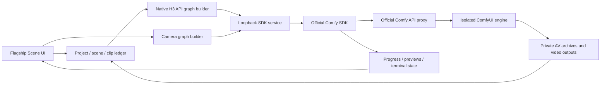

# Architecture

The studio is served as a Comfy frontend extension. Its application execution path goes through the separate official SDK service, including camera jobs; it does not silently fall back to direct native HTTP queueing. ComfyUI's ordinary model enumeration, uploads and frontend metadata remain local engine APIs. The SDK does not replace those extension APIs.

`project_store.py` owns approved clip revisions, run geometry, active jobs and batch state. `sequence_plan.py` owns scene boundaries and reference inheritance. `prompt_builder.py` constructs ordinary H3 graphs with the user's model, sampling and LoRA settings. `sdk_bridge.py` provides a same-origin bridge to the SDK service; the service persists submission keys and SDK job IDs.

The SDK key is stored before submission. Once an ID is known, recovery reads that job. A connection failure with an unknown outcome remains unresolved; it is not submitted again under a new key. Polling is authoritative after the live event stream closes. Cancellation targets the intended SDK job.

## Scene assembly

`scene_assembly.py` partitions approved clips by scene ID, runs the installed upstream Endless AV stitcher on one scene, aligns/trims its prefix once, and writes a scene MP4. Only its file manifest moves to the next scene node; decoded images are not graph outputs cached for the entire project.

After every scene succeeds, `media_concat.py` joins scene files with FFmpeg video stream copy. Audio is aligned to actual delivered frame counts and AAC-encoded; it is not advertised as lossless audio copying. Optional final upscaling follows the existing final-output setting. Normal mode keeps the original FFmpeg-only saved-clip path.

This limits assembly's live decoded data to a scene, not necessarily a small constant. A very long/high-resolution single scene can still consume substantial RAM. Scene-internal decoding and encoding still cost time. Reassembling in a new job does not currently reuse a persistent scene cache.

## Isolation

`setup.py` asks which ComfyUI folder to use and copies the engine without its custom nodes, models, inputs, outputs, user data or Git history. Public dependencies are installed into this app only. `run.py` binds three configured loopback ports and owns its child processes. A STOP marker stops those children. There is no production-server restart, queue interruption or automatic upload path in setup/run.

This release uses a self-hosted API proxy. Cloud portability of transport does not make custom-node project commits, local AV files or NVIDIA runtimes automatically available in a hosted build.
